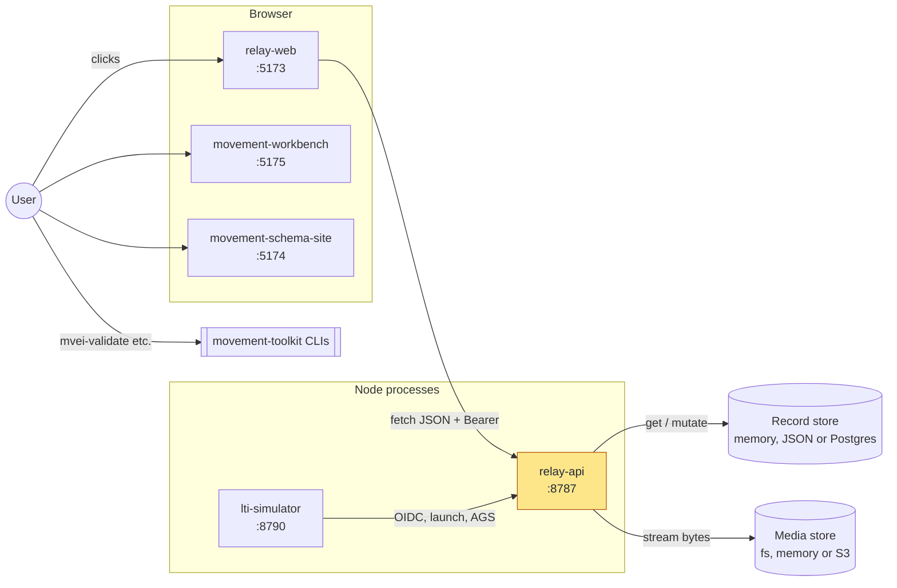
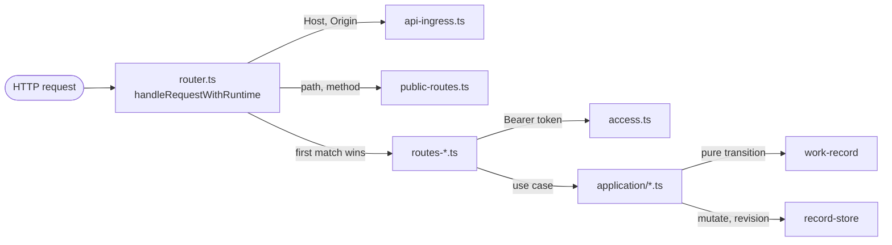
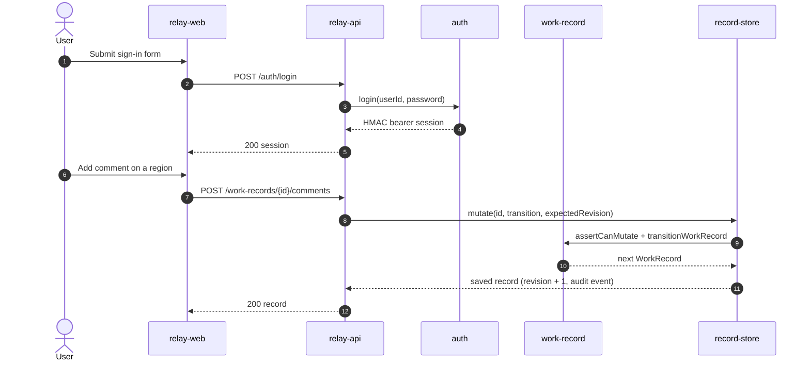
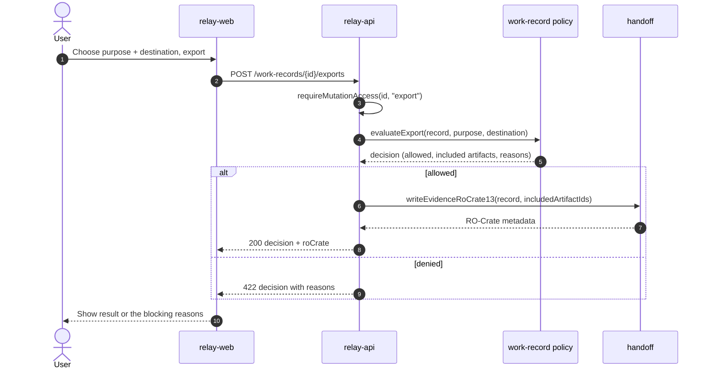
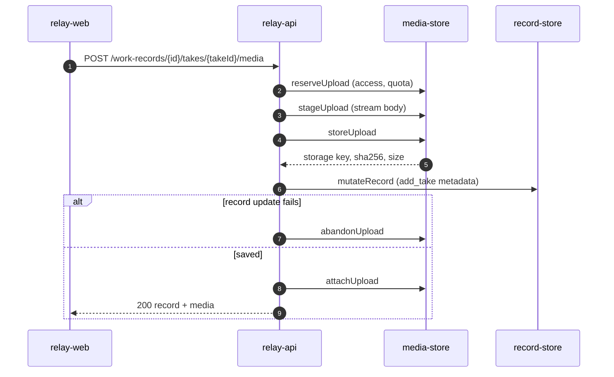
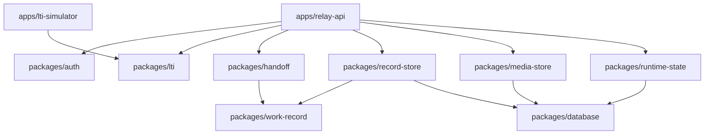
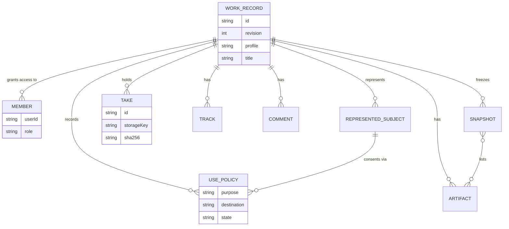
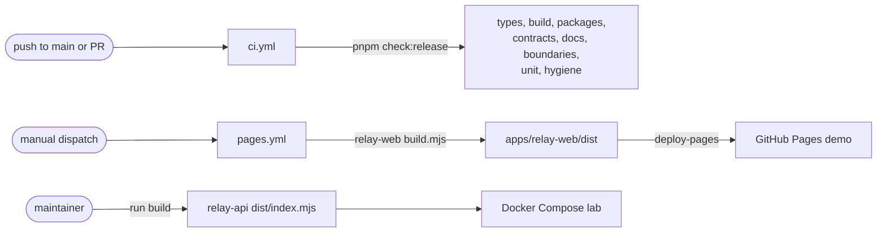

# Architecture

This monorepo holds two related systems. **Practice Relay** is a Node HTTP API
plus a static browser workspace: it accepts authenticated WorkRecord operations,
applies membership and policy rules, persists records and media, and produces
integrity-checked handoffs or declared-loss projections. **MvEI** defines
portable movement documents and supplies local authoring, reference, validation,
import, and engraving tools. A WorkRecord can carry a neutral reference to an
MvEI document, but the two domains do not depend on each other, and Practice
Relay and MvEI Workbench are not one application.

Read this page top to bottom: what runs where, what happens inside the API, three
user actions traced to code, how data is stored, how the repository is built, and
finally a code map.

## What runs where

Which processes exist and how do they talk to each other?

`relay-api` is the only process that owns state. `relay-web` is a static page
that calls the API with `fetch`; without an API it falls back to a labelled,
no-write synthetic record (this is what the GitHub Pages demo runs). The
simulator is a local LMS stand-in that drives the API's LTI routes. The three
MvEI surfaces never call the API: the Workbench and schema site are static pages
served by small dev servers, and the toolkit is a set of Node CLIs.

Where in the code:

- [apps/relay-api/src/index.ts](../apps/relay-api/src/index.ts): `createAppServer`, listener and shutdown
- [apps/relay-web/src/data/api-client.mjs](../apps/relay-web/src/data/api-client.mjs): `requestJson`, the only `fetch` wrapper
- [apps/lti-simulator/src/server.mjs](../apps/lti-simulator/src/server.mjs): simulator listener
- [packages/movement-toolkit/package.json](../packages/movement-toolkit/package.json): the `mvei-*` CLI entries

## How it runs

| Process | Start command | Default address | Notes |
| --- | --- | --- | --- |
| `relay-api` | `pnpm --filter @practice-relay/relay-api start` (after `run build`) | `127.0.0.1:8787` (`PORT`, `PRACTICE_RELAY_HOST`) | Refuses to start without strict configured users or `PRACTICE_RELAY_ALLOW_SYNTHETIC_AUTH=1`; refuses a non-loopback host unless strict secrets and users are set |
| `relay-web` | `pnpm --filter @practice-relay/relay-web dev` | `127.0.0.1:5173` (`PRACTICE_RELAY_WEB_PORT`) | Static files; the API must list this origin in `PRACTICE_RELAY_ALLOWED_ORIGINS` |
| `lti-simulator` | `pnpm --filter @practice-relay/lti-simulator start` | `:8790` (`MOCK_PLATFORM_PORT`) | Needs the same `PRACTICE_RELAY_LTI_SECRET` as the API |
| `movement-schema-site` | `pnpm --filter @practice-relay/movement-schema-site dev` | `:5174` (`MVEI_SCHEMA_SITE_PORT`) | Static |
| `movement-workbench` | `pnpm --filter @practice-relay/movement-workbench dev` | `:5175` (`MVEI_WORKBENCH_PORT`) | Static |

On startup the API builds one `ApiRuntime` from the environment
(`createApiRuntime`), then `initializeRuntime` checks the record store and
coordination state, initializes the media store, and recovers abandoned uploads.
A 30-second timer repeats that media recovery while the process runs.

Storage is chosen by environment, read once in `runtime-config.ts`:

| Setting | Effect |
| --- | --- |
| nothing set | In-memory records; lost on restart |
| `PRACTICE_RELAY_DATA=<dir>` or `PRACTICE_RELAY_STORE=json` | JSON files under `<dir>/records/*.json` with `events/*.jsonl` journals; single process only |
| `PRACTICE_RELAY_STORE=postgres` + `PRACTICE_RELAY_DATABASE_URL` | Postgres for records, login throttling, and LTI state; required for `PRACTICE_RELAY_TOPOLOGY=multi-process` |
| `PRACTICE_RELAY_OBJECT_STORE=fs` (default) or `s3` | Media bytes on disk under `PRACTICE_RELAY_MEDIA` (default `data/media`) or in S3-compatible storage |

The campus-lab Compose file runs the API from source in `node:24-bookworm-slim`
with the simulator and optional MinIO; the production-lab file builds
[deploy/Dockerfile.practice-relay-api](../deploy/Dockerfile.practice-relay-api)
and uses MinIO as the S3 store. See
[operations](relay/operations.md) and [multi-process](relay/multi-process.md).

Where in the code:

- [apps/relay-api/src/runtime.ts](../apps/relay-api/src/runtime.ts): `createApiRuntime`, adapter selection
- [apps/relay-api/src/runtime-config.ts](../apps/relay-api/src/runtime-config.ts): every `PRACTICE_RELAY_*` variable
- [apps/relay-api/src/runtime-lifecycle.ts](../apps/relay-api/src/runtime-lifecycle.ts): `initializeRuntime`, `closeRuntime`
- [docker-compose.campus-lab.yml](../docker-compose.campus-lab.yml), [docker-compose.production-lab.yml](../docker-compose.production-lab.yml)

## Inside the API: one request

How does a request move through the API's layers?

`handleRequestWithRuntime` first runs `checkApiIngress`, so a bad Host or Origin
is rejected before any credential or body is read. `publicRouteForPath` matches
the path against the public registry, which `pnpm check:contracts` keeps equal to
[openapi.yaml](../apps/relay-api/openapi.yaml); unknown paths answer 404 and
known paths with the wrong method answer 405. The router then asks each
`routes-*.ts` module in a fixed order until one returns `"handled"`. Route modules
resolve the bearer actor in `access.ts`, read the bounded JSON body, and call an
application service. Any thrown error lands in `translateRequestError`, which maps
stable error codes to statuses through `request-errors.ts` and never echoes
internal causes; every request is then counted in metrics and logged as one JSON
line.

Where in the code:

- [apps/relay-api/src/router.ts](../apps/relay-api/src/router.ts): `orderedRoutes`, `dispatch`, `translateRequestError`
- [apps/relay-api/src/public-routes.ts](../apps/relay-api/src/public-routes.ts): the route registry
- [apps/relay-api/src/access.ts](../apps/relay-api/src/access.ts): `actorFrom`, `requireActor`, `requireRecord`
- [apps/relay-api/src/request-errors.ts](../apps/relay-api/src/request-errors.ts): error code to HTTP status
- [apps/relay-api/src/api-http.ts](../apps/relay-api/src/api-http.ts): body limits, CORS, `sendJson`, `sendProblem`

## User journeys

### Sign in and comment on a record

What happens when a teacher signs in and leaves a comment?

Login (steps 2–5) is rate limited per source in `routes-auth.ts`. The browser
keeps the token and sends it as `Authorization: Bearer` on every later call. For
the comment (step 7), `handleComment` checks that the actor may add comments,
then `executeRecordCommand` calls `mutateRecord`. The membership and permission
check (step 9) runs **inside** the store's `mutate` callback against the latest
stored record, so a role change that races the request cannot be bypassed. In
Postgres mode step 8 locks the row, writes the new document, and appends the
audit event in one transaction; an `If-Match` revision that no longer matches
answers 409.

Where in the code:

- [apps/relay-web/src/data/workspace-state.mjs](../apps/relay-web/src/data/workspace-state.mjs): `login`, record loading
- [apps/relay-api/src/routes-auth.ts](../apps/relay-api/src/routes-auth.ts): `POST /auth/login`
- [apps/relay-api/src/routes-record-mutations.ts](../apps/relay-api/src/routes-record-mutations.ts): `handleComment` and the other command routes
- [apps/relay-api/src/application/mutations.ts](../apps/relay-api/src/application/mutations.ts): `mutateRecord`, `executeRecordCommand`
- [packages/work-record/src/domain/commands.ts](../packages/work-record/src/domain/commands.ts): `transitionWorkRecord`
- [packages/work-record/src/domain/access.ts](../packages/work-record/src/domain/access.ts): `assertCanMutate`
- [packages/record-store/src/postgres-store.ts](../packages/record-store/src/postgres-store.ts): transactional `mutate`

### Export evidence from the handoff review

What happens when a user asks to hand off evidence for a purpose and destination?

The decision in step 5 comes from the recorded use policies of each represented
subject; it fails closed. Only the artifacts the decision includes reach the
RO-Crate (step 6). A denial is not an error: the 422 body carries the reasons, and
the web shows them instead of a package. In demo mode the web skips steps 2–8 and
runs `simulateEvidenceExport` locally. The full record package (manifest, hashes,
ZIP) is a separate route, `POST /work-records/{id}/export`, served by
`packageExport` with `requireConsent: true`.

Where in the code:

- [apps/relay-web/src/studio/handoff.mjs](../apps/relay-web/src/studio/handoff.mjs): the handoff panel
- [apps/relay-web/src/data/studio-operations.mjs](../apps/relay-web/src/data/studio-operations.mjs): `exportEvidence`
- [apps/relay-api/src/routes-work-records.ts](../apps/relay-api/src/routes-work-records.ts): `exportRecord`
- [apps/relay-api/src/application/evidence.ts](../apps/relay-api/src/application/evidence.ts): `explicitEvidenceExport`
- [packages/work-record/src/policy/export-policy.ts](../packages/work-record/src/policy/export-policy.ts): `evaluateExport`
- [packages/handoff/src/evidence-ro-crate.ts](../packages/handoff/src/evidence-ro-crate.ts): `writeEvidenceRoCrate13`
- [apps/relay-api/src/application/exports.ts](../apps/relay-api/src/application/exports.ts): `packageExport` for the full package

### Upload media for a take

How do bytes and the record stay consistent when a recording is uploaded?

Bytes are reserved, staged, and stored before the record changes (steps 2–5), so
a record never points at missing media. If the record update fails, the stored
object is abandoned (step 7). In Postgres mode steps 6 and 9 share one
transaction. Uploads that die half way are cleaned up by the recovery loop started
in `initializeRuntime`. Downloads (`GET /media/{storageKey}`) need record
membership and a take that names that key.

Where in the code:

- [apps/relay-api/src/routes-media.ts](../apps/relay-api/src/routes-media.ts): `serveUpload`, `authorizeDownload`
- [apps/relay-api/src/application/media.ts](../apps/relay-api/src/application/media.ts): `attachStoredMedia`
- [apps/relay-api/src/runtime-media.ts](../apps/relay-api/src/runtime-media.ts): media adapter selection
- [packages/media-store/src](../packages/media-store/src): filesystem, memory, and S3 adapters

## Dependency direction

Which workspace may import which?

`relay-api` also imports `work-record` and `database` directly. On the MvEI side,
`movement-workbench`, `movement-schema-site`, and `movement-toolkit` all depend
on `packages/movement` and nothing else in the repository. Applications never
import one another, packages never import applications, cycles are rejected, and
the WorkRecord and movement domains stay independent.
[scripts/check-boundaries.mjs](../scripts/check-boundaries.mjs) enforces this in
`pnpm check:boundaries`. It also rejects Node builtins in the browser-safe
`movement` sources and relative imports that leave their own workspace; the only
exceptions are the dev servers' shared helpers in root `scripts/`.

## Data model

What is a WorkRecord made of?

A WorkRecord is one JSON aggregate: every list above lives inside the same
document and is saved as a whole, with `revision` incremented on each write.
`members[].role` (`student`, `faculty`, `admin`, `guest`) is the only thing that
authorizes access; `actors` describe who made the work and grant nothing. A
`UsePolicy` is a per-subject `granted`, `denied`, or `withdrawn` decision for one
purpose and destination, which is what the export decision reads. A `Take`
points at media bytes by `storageKey`; the bytes themselves live in the media
store. The type also carries actors, regions, versions, annotations, relations,
iterations, views, provenance, and a movement capability, omitted here.

Where each kind of state lives:

| State | Owner | Storage |
| --- | --- | --- |
| WorkRecord document and revision | `record-store` | memory; JSON `records/*.json`; Postgres `practice_relay_work_records` (`document jsonb`) |
| Record events and audit | `record-store` | JSON `events/*.jsonl`; Postgres `practice_relay_record_events` |
| Media bytes and upload state | `media-store` | filesystem or S3; Postgres `practice_relay_media_*` tables track uploads, leases, and cleanup |
| Users and sessions | `auth` | configured user file or synthetic users; stateless HMAC bearer tokens |
| Login throttling and pending LTI launches | `runtime-state` | memory, or Postgres `practice_relay_login_*` and `practice_relay_lti_launches` |
| Browser demo data | `relay-web` | static, synthetic, never written |
| Movement schemas, vocabulary, corpus | `movement` | files in the package |

Media bytes are not part of record-store backups. Missing Postgres migrations
fail closed at readiness; apply them with `pnpm migrate:postgres`.

Where in the code:

- [packages/work-record/src/domain/types.ts](../packages/work-record/src/domain/types.ts): `WorkRecord`, `Member`, `ROLES`
- [packages/work-record/src/policy/types.ts](../packages/work-record/src/policy/types.ts): `UsePolicy`
- [packages/record-store/src/migrations.ts](../packages/record-store/src/migrations.ts), [packages/media-store/src/migrations.ts](../packages/media-store/src/migrations.ts), [packages/runtime-state/src/migrations.ts](../packages/runtime-state/src/migrations.ts): Postgres tables
- [packages/record-store/src/store-paths.ts](../packages/record-store/src/store-paths.ts): JSON file layout

## Handoffs and projections

`packages/handoff` consumes a validated WorkRecord snapshot. It can create a
manifest, integrity hashes, RO-Crate 1.3 metadata, and a ZIP archive. Its OTIO,
EAF, OSC, and MusicXML-reference paths (`POST /work-records/{id}/interop`) are
projections, not replacement records, and every projection returns
machine-readable losses and omitted fields. A handoff never becomes a second
source of truth.

## Local LTI flow

`apps/lti-simulator` drives local registration, OIDC, launch, token, and
AGS-shaped requests through `packages/lti` and the API's `routes-lti.ts`. OIDC
state is bounded, expires after five minutes, and is single-use; Postgres mode
coordinates it across processes. This is a repository test flow, not a Canvas or
Moodle deployment and not IMS certification.

## MvEI

`packages/movement` is the only owner of movement schemas, schema identifiers,
vocabulary, glyph contracts, corpus fixtures, and browser-safe transforms. The
Workbench and schema site consume that package in the browser.
`packages/movement-toolkit` builds on it for Node: validation (`mvei-validate`),
intermediate LabanWriter JSON import, reference reading, capture normalization,
and engraving (`mvei-engrave`).

Motif and the pedagogical Laban subset are bounded profiles. The repository does
not implement proprietary `.lw` decoding, full professional Labanotation, or a
live capture-hardware pipeline. See [MvEI architecture](movement/architecture.md).

## Authentication and authorization

Authentication is local HMAC bearer authentication. Strict configured-user mode
requires non-empty user records with versioned scrypt password hashes
(`pnpm hash-password` creates them). Synthetic identities and development secrets
require an explicit local opt-in.

Authorization is domain-owned and record-specific. WorkRecord membership and its
role control access; roles and the permission each command needs
(`COMMAND_PERMISSIONS`) are defined once in `work-record`. Descriptive actor
roles, account defaults, and a tenant path prefix do not grant access or
establish isolation.

## Build and release

How does source become something that runs?

CI runs one job: a frozen install and `pnpm check:release`, which is
`check:all` plus public-source hygiene (lanes are listed in the
[README](../README.md#verification) and [testing](testing.md)). Pages is manual
only and publishes the static workspace with its synthetic data. Only
`packages/movement`, `packages/movement-toolkit`, and `apps/relay-api` have
compiled outputs; the API is bundled with esbuild and checked by
`check-production-runtime.mjs`. Every package stays private: nothing is published
to npm, and there is no automated deploy of the API. The repository ships
loopback dev servers and single-host Compose labs, but no TLS termination, managed
identity, high availability, backup scheduling, or orchestrator configuration. See
[lab deployment](../deploy/README.md) and [releasing](../RELEASING.md).

Where in the code:

- [.github/workflows/ci.yml](../.github/workflows/ci.yml), [.github/workflows/pages.yml](../.github/workflows/pages.yml)
- [package.json](../package.json): the `check:*` lanes
- [apps/relay-api/scripts/build-runtime.mjs](../apps/relay-api/scripts/build-runtime.mjs): API bundle
- [apps/relay-web/scripts/build.mjs](../apps/relay-web/scripts/build.mjs): Pages staging

## Invariants and extension points

- Keep `@practice-relay/*` exports and schema identifiers stable within the
  current alpha baseline unless a reviewed breaking change updates consumers,
  fixtures, and migration notes together.
- WorkRecord validation, membership access, policy, and release decisions fail
  closed.
- A handoff or projection is downstream of the canonical WorkRecord and cannot
  become a second source of truth.
- Unsupported projection information is reported, never silently discarded.
- An adapter capability selects durable behavior; it is not inferred from an
  environment variable or method name.
- New record persistence implementations satisfy the WorkRecord store port and
  belong in `record-store` or an externally injected adapter.
- New movement tools consume `movement`; they do not fork its schemas.
- HTTP statuses for domain and adapter failures come from stable error codes,
  not message text.
- `apps/relay-api` reads process configuration once; packages take explicit
  options or an injected environment object.
- Root `scripts/` holds repository-wide checks and docs/demo tooling only.
  Operational CLIs live with the workspace that owns them.

## Code map

In the order a newcomer would read it:

| Path | Responsibility |
| --- | --- |
| [packages/work-record](../packages/work-record) | The WorkRecord aggregate: types, parsing, commands, membership, policy, time |
| [apps/relay-api/src/index.ts](../apps/relay-api/src/index.ts) | API entry point and HTTP server |
| [apps/relay-api/src/router.ts](../apps/relay-api/src/router.ts) | Request pipeline and route order |
| `apps/relay-api/src/routes-*.ts` | One module per route family (auth, records, mutations, media, LTI, system) |
| [apps/relay-api/src/application](../apps/relay-api/src/application) | Use cases: mutations, media attach, exports, evidence, readiness |
| [apps/relay-api/openapi.yaml](../apps/relay-api/openapi.yaml) | External HTTP contract |
| [packages/record-store](../packages/record-store) | Memory, JSON, and Postgres record adapters, migrations, backups |
| [packages/media-store](../packages/media-store) | Filesystem, memory, and S3 media adapters and upload recovery |
| [packages/handoff](../packages/handoff) | Manifest, hashes, RO-Crate, ZIP, and lossy projections |
| [packages/auth](../packages/auth), [packages/lti](../packages/lti), [packages/runtime-state](../packages/runtime-state), [packages/database](../packages/database) | Identity, LTI helpers, shared login and launch state, Postgres pool and migrations |
| [apps/relay-web/src](../apps/relay-web/src) | Static workspace: `practice-relay-app.mjs` wires the UI, `data/` talks to the API, `studio/` holds panels |
| [apps/lti-simulator](../apps/lti-simulator) | Local LMS stand-in |
| [packages/movement](../packages/movement), [packages/movement-toolkit](../packages/movement-toolkit) | MvEI contracts and Node CLIs |
| [apps/movement-workbench](../apps/movement-workbench), [apps/movement-schema-site](../apps/movement-schema-site) | MvEI authoring and reference pages |
| [scripts](../scripts) | Repository-wide gates and docs/demo tooling |
| [deploy](../deploy) | Single-host lab deployment notes |

For subsystem details, read [Practice Relay](relay/README.md) and
[MvEI](movement/README.md).
